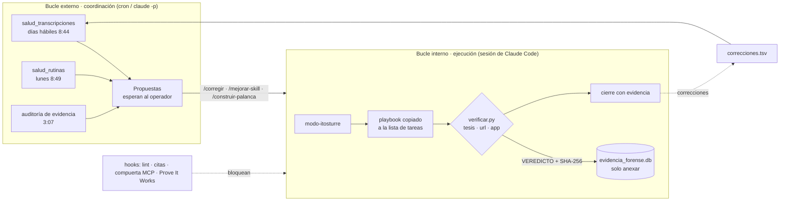

# Arquitectura de itostack

## Doble bucle

## Correspondencia con la metodología de origen

| Pieza en el texto fuente (Lauren Tan) | Equivalente en itostack | Adaptación |
|---|---|---|
| `/poteto-mode` + playbooks + principios | skill `modo-itosturre`, 11 playbooks, 13 principios | Playbooks jurídicos (redacción, validación forense, análisis, plazos) junto a los de desarrollo |
| *Prove It Works* / *Giving Agents Eyes* | `verificar.py` + `navegador_forense.ts` | La superficie real del abogado es el portal oficial: cada cita se observa ahí con captura |
| `control-glass` (Playwright + CDP) | `evidencia_web.ts` + `arrancar_app.py` | App Flask local en puerto aislado; selectores `data-testid` |
| `/create-verification-skill` + Feature Map | `crear-skill-verificacion`, `mantener-skill-verificacion`, `mapa_rutas_flask.py` | Autoprueba de seis pasos antes de entregar la skill |
| Veredictos PASS / FAIL / BLOCKED | `nucleo/veredicto.py` | Mapeados a ✅ / ❌ / ⚠ y a VVCA (Verificado, Validado, Contextualizado, Auditable) |
| Benny (triaje → reproducción doble → TDD → PR en borrador) | `reproducir-y-corregir` + subagente `reproductor` | `gh pr merge` bloqueado por hook; PR sin `--draft` bloqueado |
| Agent Evals, juez de otra familia, holdout | `claude plugin eval` + `autoprueba.py` + `compuerta_holdout.py` + `revisar_codex.py --rol juez` | La compuerta exige el visto bueno del juez de otra familia (Codex en desarrollo; Ollama local en producción) y no deja cambiarlo tras congelar; el puntaje lo calcula `nucleo/juez.py`, no el modelo; holdout protegido contra edición y lectura del agente |
| TLA+ / Lean / Bombadil | `tests/test_propiedades.py` (Hypothesis + exploración exhaustiva del contrato) | Proporcional al dominio: el invariante crítico es «no hay PASS sin evidencia» |
| `/correct`, transcript-healthcheck, routine-healthcheck | `captura_correcciones.py`, `/corregir`, `salud_transcripciones.py`, `salud_rutinas.py` | Silenciosos sin hallazgos; proponen y esperan selección |
| *Build the Lever* | `construir-palanca` | Ejemplo vivo: el verificador es la palanca que sustituye scripts ad hoc |
| Pirámide invertida (Dune, linters, no-comments) | `[[CITA:]]` + ensamblador (capa 1), IT001–IT008 + hooks (capa 2) | Las reglas de Dune no se copian: se reemplazan por las reglas del stack Itosturre |
| dr eggbot: un trabajo + anti-trabajos | 6 subagentes con `tools` restringidas y anti-trabajos explícitos | Los roles no son fronteras de credenciales: un worktree por escritor |
| `show-me-your-work` (TSV) | `muestra-tu-trabajo` + `bitacora.py` | Decisión irreversible → código 3 y detención |
| `/unslop` | `sin-relleno` + `detectar_relleno.py` | Respeta fórmulas forenses legítimas |
| `/interrogate`, `/arena` | `interrogar` + `revisor-adversarial` + `revisar_codex.py` (u Ollama local) | Coincide con el flujo multimodelo del operador (revisión adversarial) |
| `models.md` (`/setup-pstack`) | `plantillas/modelos.json` + `model:` de cada subagente | |

## Flujo de una cita

1. El agente obtiene un registro digital (búsqueda en el SJF, nunca memoria).
2. `verificar.py tesis` lanza `verificador_fuente.ts`, que visita la página de detalle y el microservicio público con `visitarConEvidencia()`: captura PNG, HTML, texto y cuerpo, cada uno con SHA-256.
3. `nucleo/veredicto.py` coteja lo citado contra lo oficial con normalización estricta (solo variaciones tipográficas); `nucleo/contexto.py` añade advertencias de corte temporal.
4. El resultado se escribe en `.itostack/evidencia/…/resultado.json` y se anexa a `evidencia_forense.db` (filas inmutables por trigger).
5. Al escribir un entregable jurídico, el hook exige evidencia PASS vigente (30 días por defecto) e íntegra para cada registro o clave; el ensamblador sustituye `[[CITA:registro]]` con los datos oficiales.

## Modo fixture

Para evals y pruebas, `verificador_fuente.ts` intercepta con Playwright las URL del SJF y responde desde `evals/fixtures/sjf/basico.json` (registros `FICT-####`, inexistentes en el SJF). Nada sale a la red, las capturas llevan una franja «FIXTURE — DATOS FICTICIOS» y la evidencia queda marcada `modo_fuente: fixture`; los hooks la ignoran en modo real.
